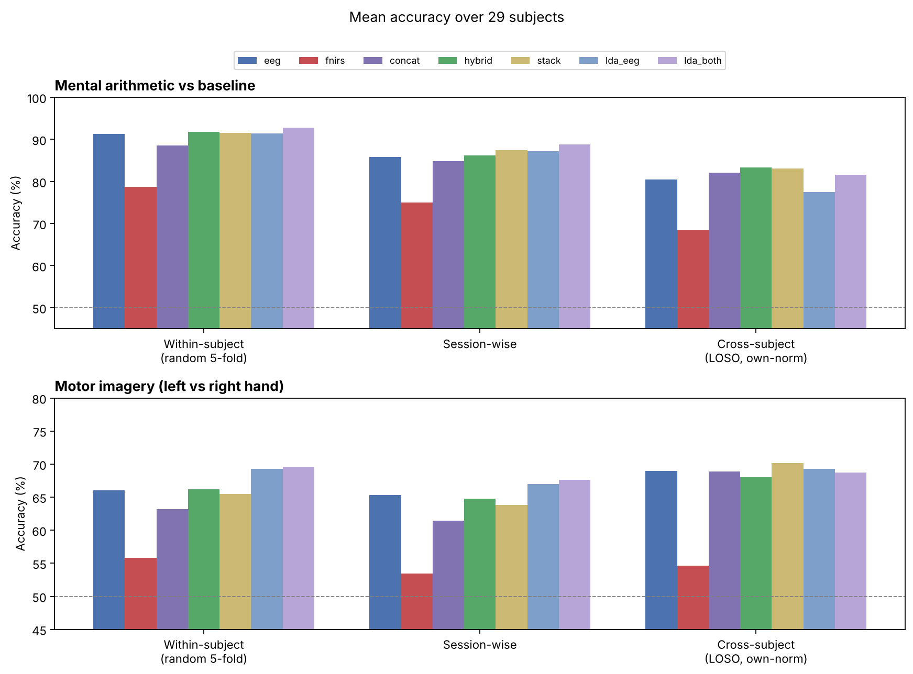
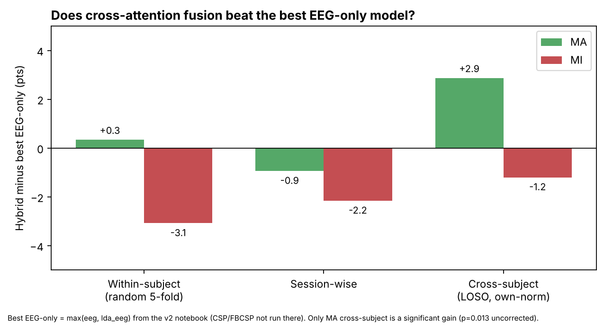
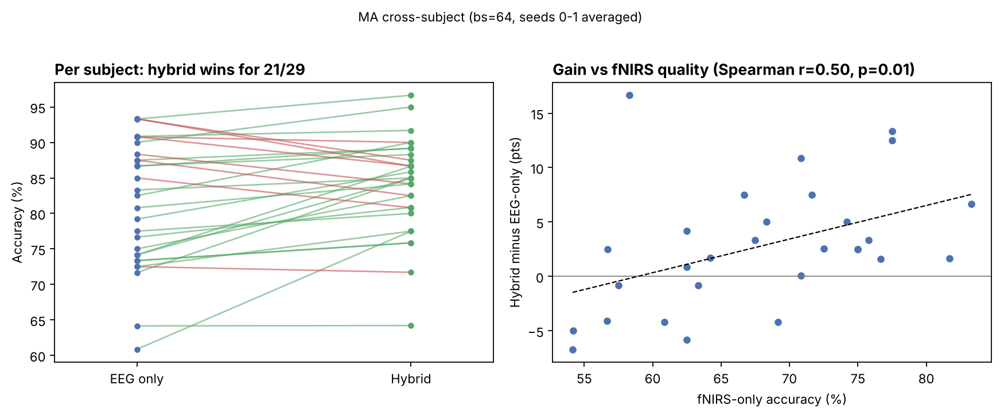
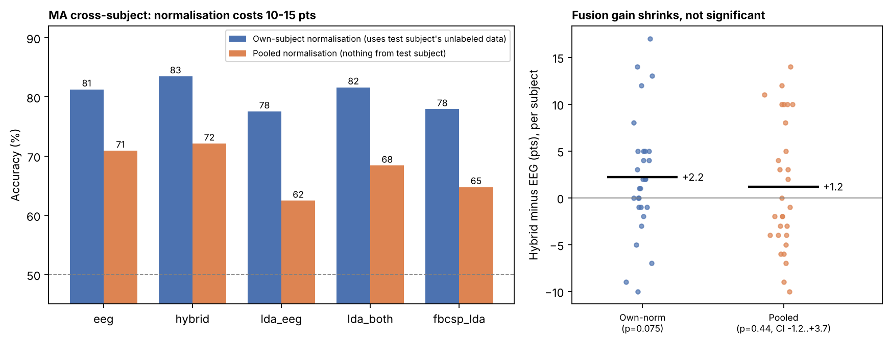
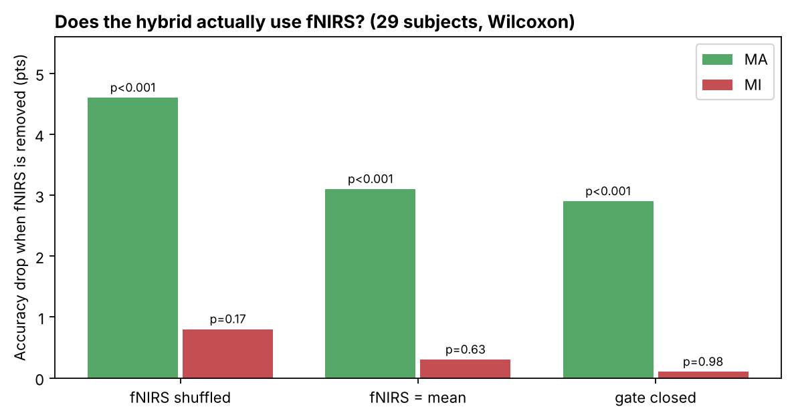

# Fusing the Spectrum: does EEG–fNIRS cross-attention fusion help?

A controlled benchmark of an EEG-queries-fNIRS **cross-attention** decoder against strong single-modality and simple late-fusion baselines on the public Shin et al. (2017) open-access EEG+NIRS dataset (29 subjects; mental arithmetic vs baseline, and left- vs right-hand motor imagery).

## Main finding

**On this dataset, cross-attention fusion shows no robust benefit** over (a) the best EEG-only model or (b) simple probability-averaging late fusion (`stack`).

- The only significant gain was **mental arithmetic, cross-subject, with per-subject (own-data) normalisation**: hybrid vs EEG-only, about +2 to +3 points.
- That gain **shrinks to +1.2 points (95% CI −1.2 to +3.7, p = 0.44) when nothing from the test subject is used** (pooled normalisation). Normalisation alone accounts for roughly 10–15 points of accuracy for every model.
- Cross-attention never significantly beats `stack` (averaging separately trained EEG and fNIRS models). It does beat feature-concatenation (`concat`) by about 3 points in MA within-subject and in MI within-subject/session-wise (Holm p < 0.05), but not cross-subject, so `concat` is the weaker late-fusion baseline.
- On motor imagery, fusion never helps; fNIRS-only accuracy is 53–59%.
- The hybrid *does* use fNIRS on mental arithmetic (removing it costs 3–4.6 points, p < 0.001, 29 subjects), so the null result is not "the model ignores fNIRS". It uses it without gaining over simpler fusion.



## Results (mean accuracy %, 29 subjects)

| Task | Protocol | Best EEG-only | Hybrid | Hybrid − best EEG-only |
|---|---|---|---|---|
| MA | within-subject (random 5-fold, 3 seeds) | lda_eeg 91.4 | 91.7 | +0.3 (n.s.) |
| MA | session-wise (3 seeds) | fbcsp_lda 87.6* | 86.2 | −1.5 (n.s.) |
| MA | cross-subject, own-norm (seed 0) | eeg 81.3 | 83.5 | +2.2 (p = 0.075) |
| MA | cross-subject, pooled norm (seed 0) | eeg 70.9 | 72.1 | +1.2 [−1.2, +3.7], p = 0.44 |
| MI | within-subject | lda_eeg 69.3 | 66.2 | −3.1 (p = 0.07) |
| MI | session-wise | csp_lda 70.8* | 65.3* | −5.4 |
| MI | cross-subject, own-norm (1 seed) | lda_eeg 69.3 | 68.1 | −1.2 (n.s.) |

\* These numbers come from an earlier run whose result files were lost in a Colab disconnect; they are transcribed from that run's printed output and could not be re-derived here. All other rows are from saved notebook output.



| | |
|---|---|
|  |  |



Fusion gain per subject rises with that subject's fNIRS-only accuracy (Spearman r = 0.50, p ≈ 0.005, MA cross-subject). fNIRS accuracy and hybrid accuracy are measured on the same test trials, so part of this may be shared noise.

## What is in the box

- `fusespec/models.py` EEG encoder (band-power sequence → transformer), fNIRS encoder (HbO/HbR → conv + transformer), cross-attention block (EEG queries, fNIRS keys/values) with scalar or input-dependent gate, baselines `eeg`, `fnirs`, `concat`, `hybrid`, `hybrid_rg`, EEGNet.
- `fusespec/data.py` loader for the `.mat` files; EEG → log band power (theta/alpha/beta/gamma, 1 s windows); fNIRS raw intensity → HbO/HbR (modified Beer–Lambert); raw-EEG cache and band covariances for CSP/FBCSP.
- `fusespec/train.py` training, three protocols (`within`, `session`, `loso`), classical references (shrinkage LDA, CSP, FBCSP), resumable benchmark, paired Wilcoxon + Holm correction + bootstrap CIs.
- `fusespec/diagnostics.py` test-time ablations (shuffled / mean / gate-closed fNIRS, EEG removed) and attention maps.
- `fusespec/synthetic.py` synthetic paired data for smoke tests.

## Evaluation design

- **Within-subject:** stratified 5-fold over the subject's 60 trials, 3 seeds. Optimistic, because trials from the same session leak across folds.
- **Session-wise:** train on two sessions, test on the third.
- **Leave-one-subject-out:** train on 28 subjects, test on the held-out one. Run twice: *own-norm* (held-out subject standardised with its own unlabeled statistics) and *pooled* (statistics from the 28 training subjects only).
- Fixed epoch budget, final-epoch model, no test-set peeking. Hybrid compared against the **strongest** EEG-only model, which makes the test conservative.

## Limitations

- The pooled-normalisation check used **one seed** and a reduced model list.
- The earlier session-wise and MI numbers marked * are transcribed, not re-run (see above).
- fNIRS-dependence diagnostics cover the plain hybrid only; the planned variants (modality dropout, pretrained encoders, input-dependent gate) were not fully evaluated.
- CSP/FBCSP were not part of the first run, and EEGNet was undertrained (79.5% MA, about 54% MI within-subject), so it is not a meaningful strong baseline.
- A single dataset, one preprocessing pipeline, small per-subject training sets (about 50 trials).

## Reproducing

Developed in Google Colab (T4 GPU recommended; a CPU-only run is roughly 3 min per held-out subject for the core models). Download the dataset from the TU Berlin page (Shin et al., 2017) and unzip EEG and NIRS into separate folders.

```python
import os; os.environ["FUSESPEC_CACHE"] = "cache"
from fusespec.data import load_cached, load_raw_cached, load_all, subject_norm
from fusespec.train import benchmark
for s in range(1, 30):
    load_cached(EEG_ROOT, NIRS_ROOT, s, "ma"); load_raw_cached(EEG_ROOT, s, "ma")
POOL = load_all(EEG_ROOT, NIRS_ROOT, "ma")
benchmark(POOL, kinds=("eeg", "hybrid", "lda_eeg", "lda_both", "fbcsp_lda"),
          protocol="loso", seeds=(0,), epochs=30, bs=64, device="cuda", out="results/ma_loso_pool.csv")
```

Results are appended per fold and skipped on re-run, so interrupted runs resume. The default cache path in `data.py` is a Colab path; set `FUSESPEC_CACHE` elsewhere.

## Data and citation

Shin, J. et al. (2017). *Open access dataset for EEG+NIRS single-trial classification.* IEEE Trans. Neural Syst. Rehabil. Eng. The dataset is not redistributed here; check its terms on the TU Berlin page.


